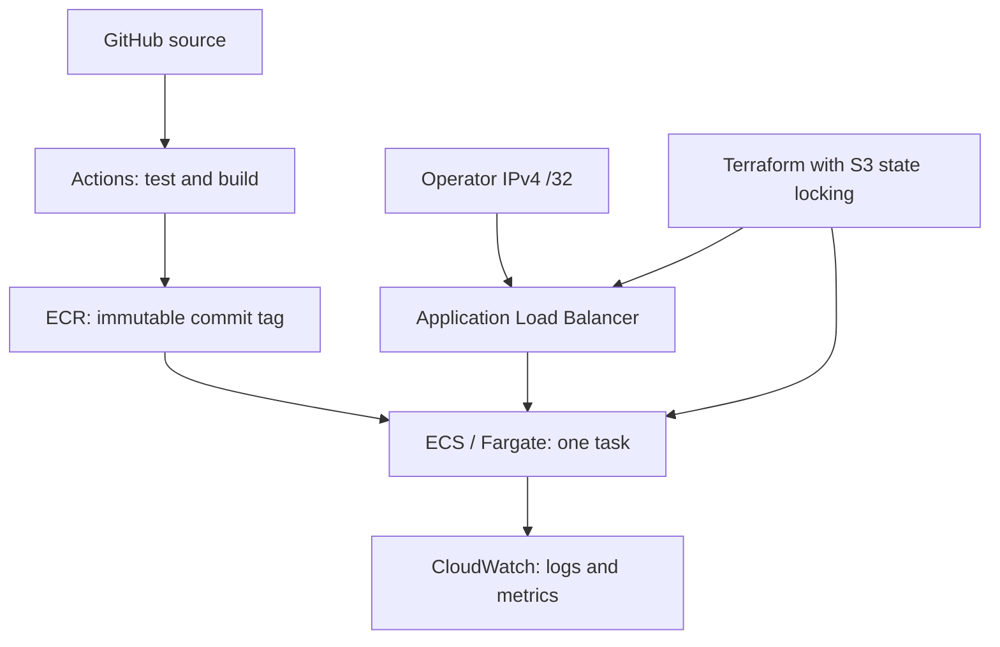

# Architecture and decisions

The browser's React UI and the Node HTTP API are served by the same container in production. Local development uses Vite with an API proxy. The application uses no database, external API, client data, or AWS credentials.

## Runtime

- `GET /health/live`: process health; stays 200 during the local readiness drill.
- `GET /health/ready`: 200 only when ready and not shutting down.
- `GET /api/status`: environment, version, commit, uptime, readiness, and drill availability.
- `GET /api/metrics`: in-memory statistics for **manual `/api/probe` requests**, plus recent process events.
- `POST /api/probe`: a test workload. Returns 503 when readiness is disabled.
- `POST /api/drills/readiness`: deliberately changes readiness only when `ENABLE_DRILLS=true`; false by default and explicitly false in AWS.

P95 uses at most the last 100 manual probes. It measures server-side handling time, not end-to-end browser latency. Metrics reset with the process. This is not a Prometheus exporter, and these counters are not sent to CloudWatch automatically. CloudWatch gets structured stdout request logs; ECS and ALB provide their own service metrics.

## Container

A multi-stage build compiles React, then copies only static assets and the Node server into the runtime image. No production `node_modules` are needed by the API. It runs as the official image's unprivileged `node` user. Compose and the CI smoke test use a read-only filesystem, drop capabilities, and disable privilege escalation. AWS uses a read-only root filesystem and UID 1000.

## AWS lab topology

Two public subnets in different available zones support the internet-facing ALB. The service runs **one** small task; this is a learning configuration, not a highly available production service. The task has a public IPv4 address for outbound ECR/CloudWatch access. Its security group accepts application traffic only from the ALB security group. The ALB accepts HTTP from one operator IPv4 `/32` only. There is no NAT Gateway.

HTTP avoids introducing a domain/certificate prerequisite. Use only synthetic lab traffic. Add HTTPS before adapting the service to real users or sensitive data.

The execution role pulls images and writes logs. The application's separate task role has no AWS policies. GitHub exchanges an OIDC token for a temporary deployment-role session. IAM trust is scoped to the repository and the `devops-lab` environment. Its deployment policy restricts infrastructure APIs by region, scopes image/state access, and scopes PassRole to the two application roles. Several infrastructure creation/describe APIs still require wildcard resources; this is a single-account learning policy, not a universal least-privilege production policy.

## Releases and recovery

ECR rejects overwriting existing commit tags. The workflow deploys a full commit tag, not `latest`. Terraform keeps the service's task definition in state. To roll back manually, choose the previous existing image tag in the manual deployment workflow, so Terraform and ECS agree on the rollback.

The ECS deployment circuit breaker is enabled. Automatic rollback needs a previously completed deployment. An initial failed deployment has no known-good deployment to return to. Health checks and circuit breakers do not replace application tests.

## State and scope

Bootstrap uses local state and creates the remote state bucket, ECR, and GitHub IAM trust/role. Keep that bootstrap state securely; do not commit it. App infrastructure uses encrypted, versioned S3 state and native S3 lock files. Each CI infrastructure test uses a mocked AWS provider and is intended to create no AWS resources.

There is no AWS auto-deployment on push. Application CI runs automatically; the AWS workflow is manual, requires setup and cost acknowledgement, and defaults to plan-only. Selecting apply is a separate explicit choice for that run. A plan-only deployment can still build/push an ECR image and use AWS APIs; it is not an offline exercise.
